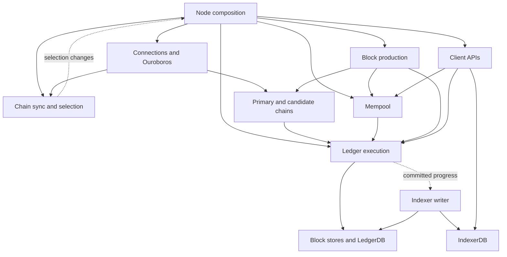
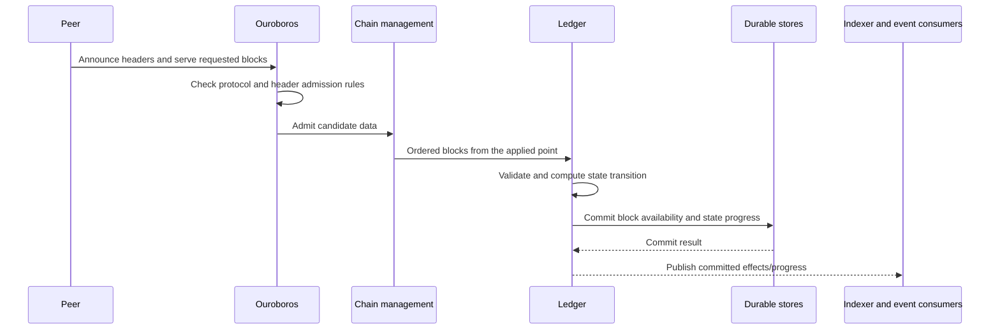

# Architecture

Dingo is a Cardano node implemented in Go. Its design separates network
transport, chain choice, ledger execution and persistence so that each has a
clear authority and can evolve without giving another subsystem control over
consensus state.

This document describes those responsibilities, their interactions and the
constraints behind them. Package and symbol reference lives with the code;
[the documentation index](docs/README.md) links implementation, configuration
and operational references.

## Design constraints

Dingo must compute the same ledger results and protocol verdicts as the
Cardano reference implementation for the network and era it joins. Sharing
results does not require copying the reference node's implementation strategy.
The node uses Go interfaces, explicit composition and storage suited to its
own execution model.

Several constraints shape the design:

- Network observations, selected chain state and applied ledger state are
  different stages. A peer's advertised tip is not proof of a valid block,
  and a stored block is not proof that its ledger effects have committed.
- Consensus reads authoritative ledger state. API indexes and off-chain
  metadata must not become validation dependencies.
- Blocks and state must remain recoverable after interruption. A persisted
  progress marker must not claim effects that cannot be reconstructed.
- Rollback is a normal operation. Derived state and event consumers must be
  able to undo a discarded branch before accepting its replacement.
- The application owns composition and resource lifetimes. Domain packages
  do not select their own providers or hide process-wide registration.

## Components and ownership

The node composition layer connects independently owned components. Solid
arrows below show synchronous dependencies or data access; dotted arrows show
notifications. They do not imply that every interaction uses the EventBus.

| Component | Authority |
| --- | --- |
| Node composition | Configuration adaptation, dependency wiring, provider selection and component lifetimes |
| Connection management | Sockets, connection ownership and transport lifecycle |
| Ouroboros handlers | Translation between mini-protocol messages and node interfaces |
| Chain sync and selection | Peer observations, candidate comparison and the choice of which peer to follow |
| Chain management | Primary/candidate block sequences, retained blocks and chain iterators |
| Ledger | Validation, applied state, epoch transitions, nonces, rollback repair and ledger queries |
| Mempool | Pending transaction admission, ordering, eviction and relay state |
| Block production | Leader scheduling, candidate construction, signing and diffusion |
| Storage | Durable block data, ledger-state transactions and independent API indexes |
| API servers | Protocol-compatible queries and transaction submission through injected services |

### Dependency boundaries

Composition belongs in the root package, `cmd/dingo` and `internal/node`.
Concrete adapters live at integration boundaries, where the application can
translate between the small interfaces domain packages expose.

The storage layer does not import ledger, mempool, networking, API or node
packages. Connection management does not know ledger rules or mini-protocol
semantics. Chain selection does not apply blocks. Ledger does not import the
IndexerDB or directly control peer governance and network connections.

Mempool validation is supplied through an interface rather than a concrete
ledger dependency. Forging receives validation, stake, clock and broadcast
interfaces. API servers expose local service interfaces; composition supplies
adapters for the ledger, indexer and mempool they need.

`event` owns the communication primitive. Event semantics and payload types
belong to the component that owns the underlying behavior. A consumer does
not gain authority to mutate the producer's state merely by subscribing.

These dependency directions are enforced by the existing
[import-boundary checks](internal/architecture/tests_test.go). The checks
protect ownership rather than prescribe the inventory of packages.

### Shared implementation boundaries

Gouroboros supplies Cardano wire protocols, CBOR and era-specific ledger
types. Dingo owns node composition, stateful validation and execution around
those types. Plutigo supplies Plutus evaluation. Producer key handling uses
Bursa. A reusable protocol or serialization change belongs at its declaring
library boundary, while Dingo retains responsibility for how it uses it.

## Block ingestion and ledger execution

The network pipeline separates discovering a possible chain from committing
its effects. Header admission, block retrieval and ledger application can
advance at different rates, so each stage validates against the state it
actually has and passes an explicit result to the next stage.

Header validation uses the network's consensus provider and ledger view,
including the applicable nonce, stake distribution and protocol parameters.
A header beyond the available forecast horizon is deferred rather than
classified as an invalid peer header. State changes can invalidate a cached
verdict, so retained candidates must be checked against the relevant ledger
generation before they are relied on again.

The ledger has one serialized block-apply authority. Decode and prefetch work
may run ahead, but stateful execution observes block order and the effects of
preceding transactions. Parallel work must be discarded or restarted when a
rollback or external ingest changes the state generation it was based on.
Performance switches may change scheduling without weakening validation.

### Validation and epoch transitions

Transaction validation resolves inputs against the ledger's current view,
including earlier transactions in the same block. Phase-2 execution must
agree with the transaction's declared validity; accepting a declaration
without checking it would change the ledger result.

Epoch transitions are ledger state transitions. Protocol parameters,
certificates, rewards, stake snapshots and governance must be evaluated at
the correct era-specific boundary, in the reference rule order. An
unavailable reward basis or inconsistent boundary state stops application;
API history and a current-state approximation cannot replace it.

Stake snapshots retain the distinction between the distribution being
captured, the distribution used for leadership and the distribution used for
delayed rewards. Their epoch labels describe capture boundaries, so a reader
must use the ledger's epoch conversions rather than infer an offset from a
name. Era-specific rules and storage representations are documented with the
[ledger](ledger/doc.go) and in [database design](DATABASE.md).

Optional consensus features that change the ledger result are network-wide
choices. They cannot be inferred from a local cache or enabled only on one
peer without a compatibility mechanism. A bootstrap format that lacks
required state cannot safely initialize that feature.

### Ouroboros Genesis trust model

The Genesis selection mode supports synchronization from origin without
turning a single peer's longest-chain claim into a trust anchor. Candidate
fragments, their common intersection and observed density provide evidence
for selection while ordinary header and block validation still applies.

The Limit on Eagerness constrains progress beyond corroborated history;
density comparison and the Density Disconnector evaluate competing
candidates, while the Limit on Patience prevents a selected peer from holding
synchronization indefinitely without progress. Candidate evidence must retain
the required history window and identify the actual fork intersection.

Near the tip, selection uses the consensus provider's Praos comparison.
Genesis/Praos mode changes follow synchronization state; they are not a
permission to bypass validation. Details of candidate retention and
corroboration belong in [chain selection](chainselection/doc.go); operator
configuration belongs in [Genesis synchronization](GENESIS_SYNC.md).

## State authority and persistence

Storage is divided by responsibility, not by which component finds a backend
convenient. The ledger's live state is authoritative for validation. API
history is a derived view that may lag without changing consensus results.

| Store | Role |
| --- | --- |
| ImmutableDB | Stable ranking-block history in chunk files |
| VolatileDB | Recent ranking blocks and branches needed for rollback |
| LeiosDB | Endorser-block bodies and manifests, with volatile and immutable retention |
| LedgerDB | Current consensus state and the journal needed to restore earlier states |
| IndexerDB | Independently maintained history and indexes for API queries |

The application injects stores through domain contracts. The ledger's
LedgerDB roles cover UTxOs, accounts, pools, rewards, snapshots, governance,
epochs and chain state. API-specific query requirements do not widen that
contract into a general historical database API.

The ledger database opens without an SQL metadata store. Its live state is
held in the journaled Badger set. The API-mode IndexerDB has its own metadata
store and progress point. Some composition and backfill adapters still read
retained ledger facts; those adapters do not give validation a dependency on
the indexer.

### Commit and recovery guarantees

Block availability and applied-state progress have different durability
roles. Recoverable ordering permits block storage to be ahead of the applied
point, because the ledger can replay those blocks. It must not leave the
applied point ahead of the durable blocks needed to reconstruct its effects.

Coordinated commits make block writes durable before advancing their
committed progress. A retreat records the lower point before removing state
and retains recovery intent until the retreat is complete. A crash at an
intermediate step must leave enough information to replay or repeat the
operation rather than mistake partial work for completion.

Startup reconciles the selected chain, durable applied point and LedgerDB
journal before serving state or applying new blocks. A LedgerDB ahead of its
recorded point is brought back through the journal. A point no longer on the
selected chain is reconciled to an actual common ancestor, not merely a
numerically lower slot on another branch.

The journal is retained through the rollback window and cannot be pruned past
the immutable anchor needed for recovery. If it cannot reach the required
state, recovery uses a matching checkpoint or an authenticated ledger import
and replays retained blocks. Missing recovery material is an error; current
state cannot be relabeled as an older snapshot.

Commit ordering, recovery markers, encodings and backend-specific behavior
are specified in [DATABASE.md](DATABASE.md). They are not duplicated here.

### Indexer isolation and retention

The indexer follows committed ledger progress and commits its rows and its
own tip together. A notification wakes it; the durable ledger tip and block
history determine what to index. Startup and catch-up therefore do not depend
on receiving every historical wake notification.

Rollback brings the indexer's view back to the surviving lineage. Historical
API reads use the IndexerDB, while consensus reads continue to use the
LedgerDB. Query readiness and a pinned point must reflect the store that
actually serves the query; a lagging indexer cannot claim a newer ledger view.

Core mode keeps the data needed to validate, forge and serve the chain. API
mode additionally maintains the IndexerDB. Archive retention and history
expiry govern stored payload availability independently of ledger validity;
pruning payloads must preserve live outputs, rollback requirements and the
trust boundary from which the node can recover.

The operator selects the storage mode; consumers do not promote it. Every
storage consumer, whether a plugin provider or a built-in service, declares the
minimum ordered tier (`core` or `api`) and the named storage features it needs.
Node composition aggregates the enabled declarations and refuses startup before
opening storage when the selected mode does not include a consumer's tier,
naming each incompatible consumer. UTxO RPC, MCP and Bark run in core mode:
UTxO RPC reads live outputs and inline datums from the ledger's UTxO set and
refuses transaction lookups, which need API storage. The declarations are
derived again on every startup and add no persisted database contract.

## Rollback and event consistency

A rollback changes a chain lineage, not just a height. The ledger identifies
the surviving point, serializes against in-flight application, restores state
and invalidates work derived from the discarded branch. A fresh iterator must
resume from the surviving applied point rather than continue a stale read.

The operation retains the blocks and journal data needed to undo the applied
branch even when chain selection has already replaced the primary sequence.
Reading the new primary chain at the old slots cannot reconstruct the old
branch's effects.

A competing suffix does not replace the primary chain on header evidence
alone. Its bodies are fetched into an isolated candidate and validated from
the common ancestor in a ledger transaction that is always rolled back, while
the primary chain and ledger tip stay unchanged. The switch proceeds only if
the primary tip and consensus generation still match those used for
selection and validation; an incomplete, stale or invalid candidate is
discarded.

Rollback below an imported Mithril trust boundary is refused. The node does
not possess the earlier state needed to justify such a rewind. Recovery must
respect that boundary instead of truncating until a local inconsistency
appears to disappear.

### ledger.tx

Forward transaction events describe committed ledger effects; a failed
transaction commit publishes none. Undo events describe the branch the
ledger actually applied. Undo must reach an ordered consumer before later
forward effects from the replacement branch.

The transaction event lane orders events of that type, but multiple publishing
goroutines still require serialization before enqueueing. Rollback retains a
durable intent across state truncation and event publication so interruption
does not silently lose the undo. Recovery may redeliver effects, so consumers
must account for the stream's recovery contract rather than assume exactly
once delivery.

The live UTxO set is updated as part of the ledger's commit path, rather than
being reconstructed by an ordinary event subscriber. Its recorded point must
identify the state the set actually contains. External consumers of UTxO
changes receive committed changes in their ordered lane.

## Block production and consensus providers

A consensus provider determines header eligibility, chain comparison and
production scheduling. The same selected provider is used by relay and
producer paths. The ledger supplies state; the producer owns signing
credentials and candidate construction.

Leader scheduling uses the correct epoch nonce and stake snapshot. The
forger builds from the applied ledger state and the mempool's transaction
order, validates the candidate and signs it before publishing it into chain
management and diffusion. A forged-but-unapplied block is a separate pipeline
stage; comparisons against the applied tip must not treat that difference
alone as evidence of a competing producer or stale state.

A node may manage several pool producers. Their credential ownership and
slot arbitration must prevent conflicting signing attempts and preserve
shared KES state. A remote KES agent moves signing authority behind an
explicit signing interface without moving block validation out of the node.

Consensus provider identity is part of network and database compatibility.
An alternative algorithm must use a distinct identity and prevent incompatible
peers or persisted schedules from being accepted as ordinary Praos state.
Provider selection is not a way to reuse incompatible state silently.

### Leios

Leios separates ranking blocks from endorser blocks, votes and certificates.
Ranking-chain synchronization alone does not establish the availability or
validity of the transactions referenced by an endorser-block closure.

Announcements, body retrieval, validation, committee voting and certificate
formation are separate stages. Only an authenticated, validated certified
closure may contribute ledger effects. Pending work and rollback handling
must preserve the association between an endorser block and the ranking
chain that made it applicable.

Leios storage and committee state have their own ownership, but transaction
execution still uses the ledger's ordered state transition path. Protocol
construction and voting rules belong with [the Leios implementation](ledger/leios/doc.go).

## Composition and resource lifecycle

Node composition owns one in-process `plugin.Host`. Providers register
explicitly on that instance. Factories retain typed configuration and service
contracts; registry type erasure stays at the host boundary. Domain packages
neither self-register during initialization nor share a global registry.

A capability names a versioned contract. Configuration selects a provider for
that contract; the host rejects undeclared or incompatible selections.
Configuration precedence is CLI, environment, YAML, then defaults. Parsing
rules and provider configuration are defined by their owning types and the
[plugin development reference](database/plugin/PLUGIN_DEVELOPMENT.md).

Startup resolves consensus before opening storage, constructs the ledger and
mempool, then starts enabled client services against ready dependencies.
Failures unwind acquired resources. Normal shutdown stops consumers before
the dependencies they use, and the host tears down providers in reverse
start order.

### Live database lifecycle

Snapshot, restore and truncate operations cross component lifetimes.
Composition quiesces writers and dependent services before replacing stores,
then recreates dependent components with the same effective configuration
and adapters. A live replacement must not retain handles into the retired
store or leave a worker acting on an earlier component generation.

Cancellation bounds waiting; it does not prove that an underlying storage
close has finished. If draining ownership cannot be confirmed, the node
requests a supervised restart rather than reopen the same data directory
under an outstanding owner. A successful reconstruction must establish the
same validation and provider configuration as initial startup.

Snapshots represent a consistent point across the stores they include.
Snapshot trust and payload integrity are checked before an imported snapshot
becomes serving state. Local snapshot completion and successful cloud
publication are distinct facts; retry and retention use durable completion
state rather than infer success from a directory's presence.

### Bootstrap and external ingest

Mithril bootstrap authenticates an imported ledger state and establishes a
trust boundary. Imported state must be complete for the supported era before
network execution continues. A partially imported set is marked and cannot
be served as a completed ledger state.

Certified stream catch-up and manual loading reuse the ledger's execution
engine. External ingest pauses normal application and checks the expected
applied point so two writers cannot commit competing continuations. Blocks
stored by an interrupted batch remain replayable from the durable point.
Network discovery and rollback have their own coordination; pausing one loop
is not proof that the rest of the node has stopped.

The SDK is a separate module for plugin and chain-role contracts. It cannot
import the node module or its internal packages, and Cardano-specific types
are isolated under `sdk/cardano`. The current role adapters describe seams;
they do not yet replace the node's execution paths. Import-boundary checks
cover both modules.

## Concurrency and communication

Mutable ledger state has a serialized writer. Queries read a consistent view
at the requested point or return an explicit unavailable-state error.
Decoded objects shared through caches are immutable after publication;
workers must not initialize or mutate fields after exposing them to peers.

Synchronous reads use injected interfaces or callbacks. Cross-component
notifications use the EventBus. Synchronous publication, unordered async
publication and per-type ordered publication are different contracts; a
caller chooses the one its consumer needs. Ordering one event type does not
order separate types or concurrent publishers automatically.

Delivery applies backpressure instead of silently losing a live consumer's
work. Ordinary stalled subscribers can be detached under their delivery
policy; consumers that require lossless delivery select the corresponding
policy explicitly. A publisher must not hold a lock its subscriber needs,
because a full queue would turn that dependency into a deadlock.

Components own the goroutines and subscriptions they start. Shutdown cancels
work, releases blocked publishers and drains tracked workers before closing
the resources those workers use. Store replacement pins operations to the
store generation that created their transaction and waits for old users
before closing it. Request cancellation belongs to the serving instance so
closing an old connection cannot cancel a replacement's requests.

Event delivery details are specified in [event/doc.go](event/doc.go). Local
lock protocols, queue sizing, timers and worker scheduling are documented
beside their implementation.

## External interfaces

Node-to-node protocols exchange chain data and participate in peer governance.
Node-to-client and application APIs expose ledger queries, indexed history and
transaction submission through their respective services. Query adapters
select authoritative current state or the independent history index according
to the request, rather than redirecting validation through an API database.

Bark exposes node management, database lifecycle and event services. Its
remote event stream is a separate delivery boundary; slow remote clients
must not hold the internal ledger's event consumers. MCP, Midnight and DMQ
have dedicated adapters and lifecycle ownership. Off-chain metadata enriches
API results without becoming consensus input.

### API restrictions

Dingo implements upstream API contracts. Client-facing APIs support anonymous
requests over plaintext HTTP and retain their wildcard/all-interface binding
behavior. TLS remains optional.

APIs are unrestricted by default: there is no default-on rate limit,
admission pool, client/stream/session cap, concurrency cap or work budget.
Any supported operator limit is an explicit opt-in, with zero or unset
meaning unlimited. Protocol correctness limits and node-to-node peer
protections are separate concerns.

### API security

Shared TLS configuration and per-provider overrides are resolved at the
composition boundary and passed to each server. The same effective policy
must survive live restore and truncate. Listener ownership follows the
server lifecycle, including sockets supplied by an embedding application.
Configuration-field precedence and certificate loading are specified in
[the configuration example](dingo.yaml.example) and
[API configuration](internal/apiconfig).

## Design references

- [Database design](DATABASE.md): storage contracts, persisted formats,
  commit ordering and recovery.
- [Go code reference](docs/code-reference.md): package and exported-symbol
  documentation for the checked-out revision.
- [Plugin development](database/plugin/PLUGIN_DEVELOPMENT.md): provider
  contracts and composition.
- [Genesis synchronization](GENESIS_SYNC.md): synchronization policy and
  operator configuration.
- [Koios parity](internal/koiosparity/README.md): epoch alignment and the
  validation coverage matrix.
- [Node parity](internal/nodeparity/README.md): running the live comparison
  tests against a reference node or Koios.
- [MCP design](docs/mcp/architecture.md): the MCP adapter's internal structure.
